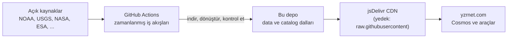

# YZR Net

[yzrnet.com](https://yzrnet.com/)

---

## ✨ Hakkında

YZR Net, farklı alanlarda ihtiyaç duyulabilecek araçlar, uygulamalar ve dijital deneyimler geliştirmeyi amaçlayan bağımsız bir projedir. Kullanışlı, erişilebilir ve mümkün olduğunca sade çözümler sunmayı; bunu yaparken hesap oluşturma, ek yazılım kurma veya kişisel verileri bir sunucuya gönderme zorunluluğunu ortadan kaldırmayı hedefler. Araçların büyük bölümü doğrudan kullanıcının tarayıcısında çalışır.

## 🧭 Açık Veri Altyapısı

Bu depo, YZR Net'in (özellikle 3B evren uygulaması Cosmos'un) kullandığı açık veri akışlarını üretir ve yayımlar. Farklı kamuya açık kaynaklardan alınan veriler, tarayıcıda doğrudan kullanılabilecek küçük dosyalara dönüştürülür. Depo web arayüzüne değil, bu veri altyapısına odaklanır. Kullanılan veriler kendi kaynaklarının lisans ve atıf koşullarına tabidir.

### Nasıl çalışır

1. **Klasörler.** `main` dalında her akışın kendi klasörü vardır (`data/wind`, `data/stars`, `data/asteroids` ...): üretici betik (çoğunlukla Python) ve gerekirse küçük bir README. `.github/workflows/` her akış için bir iş akışı, `.github/scripts/publish.sh` ortak yayın betiğidir.
2. **Üretim.** Her iş akışı zamanlanmış çalışır (GitHub Actions `cron`) ve elle de başlatılabilir. Kaynağı indirir, dosya boyutunu ve içeriği denetler, sonucu üretir. Denetimden geçmezse yayımlanmaz, önceki sürüm yerinde kalır. Gizli bilgi veya API anahtarı gerekmez.
3. **Yayın.** `publish.sh` sonucu, geçmişi tutmayan (tek commit'lik) bir dala yazar: sık güncellenen ve küçük akışlar **`data`** dalına, büyük kataloglar (yıldız, asteroit, galaksi, Samanyolu) **`catalog`** dalına. Böylece depo geçmişi şişmez.
4. **Dağıtım.** Dosyalar önce **jsDelivr** (`cdn.jsdelivr.net/gh/LykosTR/yzr-net@data/...`) üzerinden, olmazsa **`raw.githubusercontent.com`** üzerinden okunur. jsDelivr dosyaları kenarda saklar; bu yüzden her yayından sonra güncellenen dosyaların önbelleği temizlenir (en geç birkaç dakika içinde yeni sürüm gelir).
5. **Kullanım.** Cosmos ve araçlar bu dosyaları tarayıcıda okur. Dosya alınamazsa ilgili canlı servise düşer.

### Biçimler ve sıklık

- **İkili (`.bin`) ve JSON:** büyük sayısal diziler (rüzgâr ızgarası, yıldız ve galaksi katmanları) küçük ikili dosyalardır; yanlarındaki `meta.json` sürüm ve boyut bilgisini verir. Küçük listeler (yörüngeler, depremler) JSON'dur.
- **Doku ve harita:** yüzey haritaları ve bulut katmanları görüntü dosyalarıdır (WebP ve benzeri), parçalara bölünmüş olabilir.
- **Sıklık:** aşağıdaki tabloda. Zamanlama olmayan akışlar (yüzey haritaları, dokular, atmosfer tabloları) yalnızca kaynak ya da yöntem değişince elle yeniden üretilir.

## 📡 Açık veri akışları

| Akış | Ne | Kaynak | Güncelleme |
|---|---|---|---|
| Rüzgâr | 10 m, 1° küresel rüzgâr | NOAA GFS | 6 saatte bir |
| Depremler ve yangınlar | Son 24 saat | USGS, NASA VIIRS | 30 dakikada bir |
| Kutup ışığı | Tahmin haritası | NOAA SWPC | 10 dakikada bir |
| Okyanus akıntıları | Yüzey akıntıları | Copernicus Marine | saatte bir |
| Gök cisimleri | Gezegenler, uydular, asteroit yörüngeleri, Ay konumu | NASA/JPL Horizons, SBDB | saatte bir |
| Kuyruklu yıldızlar | Tüm kuyruklu yıldızlar (~4100) | NASA/JPL SBDB | 6 saatte bir |
| Asteroit kataloğu | Numaralı tüm asteroitler | NASA/JPL SBDB | günde bir |
| Yıldız kataloğu | En parlak 1 milyon yıldız | ESA Gaia DR3, HYG v4.1 (CC BY-SA 4.0) | haftada bir |
| Galaksi kataloğu | ~50 bin galaksi | HyperLEDA | ayda bir |
| Samanyolu panoraması | 360° galaktik görüntü | ESO / S. Brunier (CC BY 4.0) | ayda bir |
| Yüzey haritaları | Ay, Merkür, Venüs, Mars, Ceres, Pluto ve büyük uyduların renk ve kabartma haritaları | USGS Astrogeology, NASA (LRO, MESSENGER, Magellan, Viking, MOLA, Dawn, New Horizons, Galileo, Voyager, Cassini), DLR | — |
| Diğer cisim dokuları | Dev gezegenler, asteroit kayası; Uranüs uyduları, Haumea, Gonggong ve Sedna (temsilî) | NASA/JPL ve görev ekipleri; [Astra-Planetshine](https://www.deviantart.com/astra-planetshine) (sanatçının izniyle) | — |
| Dünya atmosferi | Saçılma tabloları (gökyüzü, alacakaranlık, pus) | Hillaire (2020), Bruneton (2017) modelleri | — |
| Bulut katmanı | Dünya bulut dokuları | [SatVisor](https://github.com/satvisorcom/satvisor), AGPL-3.0 | — |
| Dünya haritası ve hava | Uydu görüntüsü, 3B harita, hava durumu (depoda tutulmaz) | Esri, ArcGIS, Open-Meteo (doğrudan servisten) | canlı |

## 🧰 Sitedeki araçların kaynakları

Sitedeki haritalar ve araçlar bu servisleri kullanır; atıflar ekranda değil burada ve [Hakkımızda](https://yzrnet.com/about#ab-veri) sayfasında toplanır.

| Ne | Nerede | Kaynak |
|---|---|---|
| Uydu görüntüsü | IP sorgulama haritası, ana sayfadaki Dünya | Esri World Imagery: Esri, Maxar, Earthstar Geographics |
| Harita, yer adları, yollar | IP sorgulama haritası | [OpenFreeMap](https://openfreemap.org/) (OpenMapTiles), © [OpenStreetMap](https://www.openstreetmap.org/copyright) katkıda bulunanlar |
| Arazi yükseltisi | IP sorgulama haritası, Arazi katmanı | [Mapterhorn](https://mapterhorn.com/) |
| IP konumu ve ağ bilgileri | IP sorgulama | RIPEstat, RDAP, ipapi.is, ip-api, country.is, OpenStreetMap Nominatim, Cloudflare DNS, ipify; bayraklar flagcdn.com |
| Döviz kurları | Birim çevirici | [Frankfurter](https://frankfurter.dev/) (Avrupa Merkez Bankası) |
| Arka plan silme modeli | Arka plan silme | IMG.LY background-removal, IS-Net (AGPL-3.0) |

## ⚖️ Lisans ve atıf

- **Kod** (betikler, iş akışları): [MIT](LICENSE). Kopyalarda telif satırı korunmalıdır.
- **Bu deponun ürettiği veri dosyaları:** [CC BY 4.0](LICENSE-DATA.md). Kullanan herkes **“YZR Net”** adını ve [yzrnet.com](https://yzrnet.com/) ya da [github.com/LykosTR/yzr-net](https://github.com/LykosTR/yzr-net) bağlantısını belirtmelidir.
- Kaynağının lisansı daha sıkı olan veriler o lisansla dağıtılır (yıldız kataloğu CC BY-SA 4.0, bulut katmanı AGPL-3.0). Üçüncü taraf kaynakların koşulları ayrıca geçerlidir.

© 2026 YZR Net
